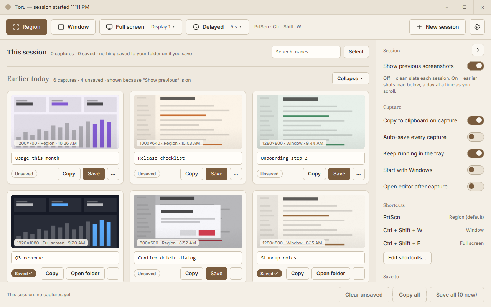
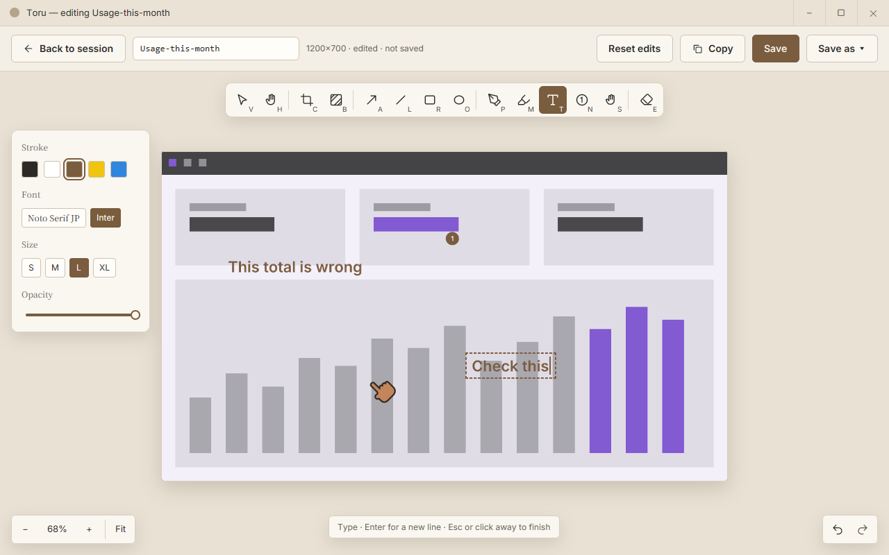
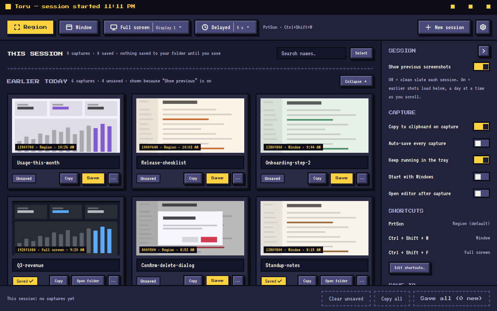
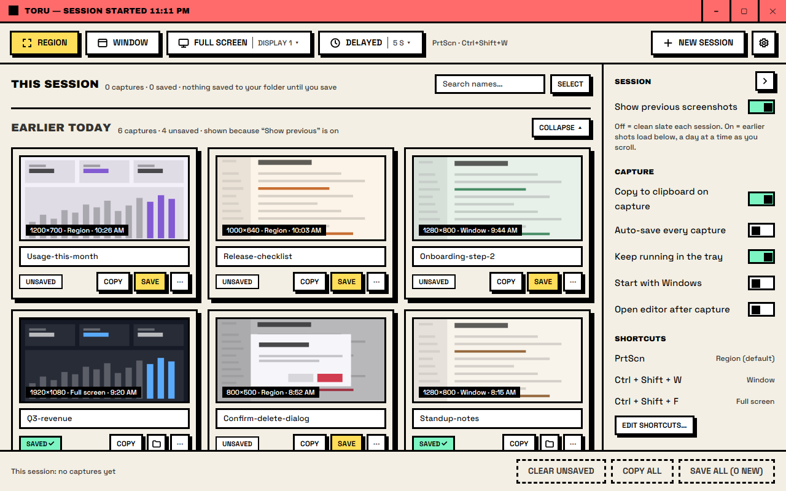

<div align="center">


# Toru

A screenshot app for Windows. Captures stay temporary until you save them.

[](https://github.com/ChacaPatrick/toru/releases/latest)
[](LICENSE)


**[Download the latest release](https://github.com/ChacaPatrick/toru/releases/latest)**

</div>

Toru captures a region, a window or a whole screen, copies it to the clipboard and keeps it in a gallery. You name
it, then save it, copy it or leave it: nothing goes into your screenshots folder until you save, and what you never
save is cleared out after 30 days. It is built with [GPUI](https://www.gpui.rs/).



| Editor | Pixel art look | Neo-brutalism look |
|---|---|---|
|  |  |  |

## Features

- **Capture** a region, a window, a full screen on the display you pick, or any of them after a 3, 5 or 10 second
  delay. The region overlay shows the size and a magnifier.
- **Temporary until saved.** A capture lands on the clipboard and in the gallery. Save writes it to your folder as
  PNG, JPG or WebP under a name pattern you set. Auto-save is there if you want every capture kept.
- **Gallery.** "This session" sits on top, and earlier days load below as you scroll, saved and unsaved alike. Unsaved
  captures are deleted after 30 days; pick another count or Never. Files you saved are never touched.
- **Editor.** Crop; blur, pixelate or block out; arrows, lines, rectangles and ellipses; pen and highlighter; text,
  number badges and stickers; an eraser; undo and redo. The original is kept until you save, and Reset edits brings
  it back.
- **Select mode.** Pick several captures, then copy them as files, copy their paths, save them or delete them.
- **Three looks.** Japandi, Pixel art and Neo-brutalism, each with three palettes and a custom one with your own
  colours and an optional background photo.
- **Tray and shortcuts.** Toru keeps running in the tray, and its global shortcuts capture from anywhere. Rebind
  them, or give each display its own.
- **Updates itself** from GitHub Releases, and shows the patch notes before installing.
- **Keyboard.** Tab and the arrow keys reach every control and card, with a visible focus ring. Animations follow
  Windows' setting.

## Install

Download the latest `Toru-<version>-setup.exe` from the [Releases page](https://github.com/ChacaPatrick/toru/releases/latest)
and run it. It installs for your user only, with no admin prompt. The installer isn't signed yet, so Windows SmartScreen
warns "Windows protected your PC" the first time: choose **More info**, then **Run anyway**.

You only do this once: Toru updates itself after that.

Toru runs on 64-bit Windows 10 and 11. It is developed and tested on Windows 11.

## Default shortcuts

These work from anywhere while Toru is running. Change them with **Edit shortcuts…** in the settings column.

| Shortcut | Capture |
|---|---|
| `PrtScn` | Region |
| `Ctrl` + `Shift` + `W` | Window |
| `Ctrl` + `Shift` + `F` | Full screen |
| not set | Delayed, and full screen on one display |

In the editor each tool has a key: `V` Select, `H` Pan, `C` Crop, `B` Block, `A` Arrow, `L` Line, `R` Rectangle,
`O` Ellipse, `P` Draw, `M` Highlighter, `T` Text, `N` Number badge, `S` Stickers, `E` Eraser.

## Privacy

Toru has no account and no telemetry. Captures stay on your PC: unsaved ones in `%LOCALAPPDATA%\Toru`, saved ones in
the folder you chose.

The only thing Toru uses the network for is updates. When it starts, and every six hours after, it reads the latest
version from this repository's GitHub Releases and downloads the installer if there is a newer one. **Check for
updates** in the settings column turns that off.

## Building from source

You need [rustup](https://rustup.rs/) and the Visual Studio C++ build tools with the Windows SDK. rustup installs the
toolchain pinned in [`rust-toolchain.toml`](rust-toolchain.toml) by itself.

```powershell
cargo run -p toru
cargo test --workspace
```

- `TORU_DATA_DIR` points a run at another data folder, which keeps it out of your own history.
- Only release builds look for updates. `TORU_UPDATE_URL` names another `toru-update.txt`, which may be a `file://`
  URL, to try the update flow in any build.

The installer is in [`installer/`](installer/README.md), releasing in [`docs/RELEASING.md`](docs/RELEASING.md), the
design in [`design/`](design/) and the build plan in [`docs/PLAN.md`](docs/PLAN.md).

## Known issues

See [`docs/KNOWN_ISSUES.md`](docs/KNOWN_ISSUES.md).

## Licence

Toru is under the [MIT licence](LICENSE). The bundled fonts are under the SIL Open Font License 1.1
([`assets/fonts/`](assets/fonts/)).

Created in [T3 Code](https://t3.codes).
